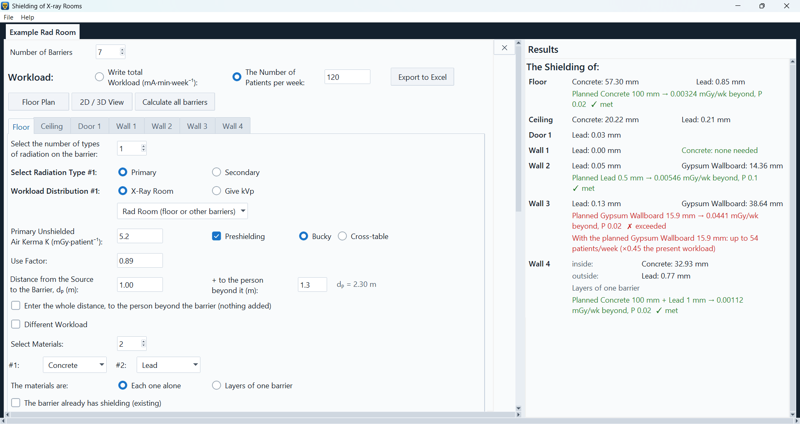
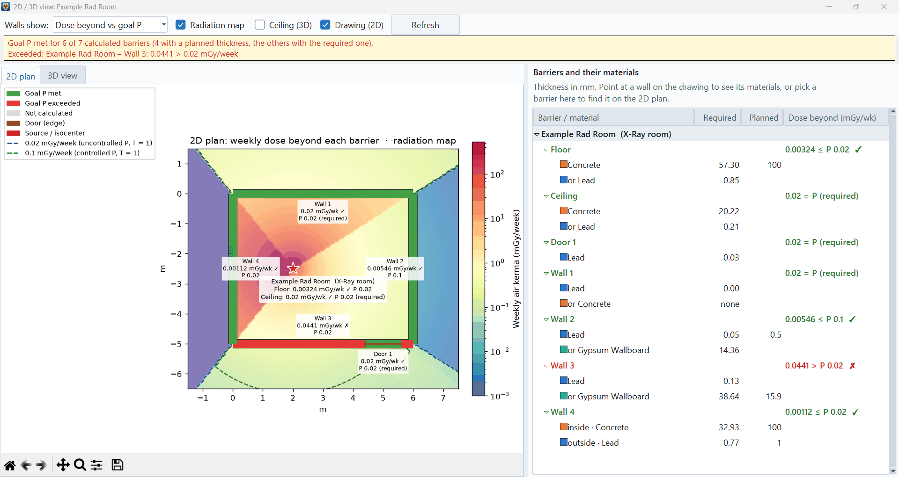

# Shielding of X-ray Rooms

A desktop program for the **structural shielding design of medical X-ray imaging facilities**, following
**NCRP Report No. 147** (2004). It works out how thick the walls, doors, floor and ceiling of a room must be, and checks
the thickness you plan to install.



## What it does

- **Room types**: X-ray rooms (radiography, chest, modern digital radiography), fluoroscopy rooms (R&F, cardiac and
  peripheral angiography, interventional rooms; also the radiographic workload of NCRP 147 for patients who have only
  radiographs there), CT rooms (from the DLP, with the scans or phases per procedure) and
  mammography rooms, including digital breast tomosynthesis.
  You can also design **departments**, with several rooms on one floor plan.
- **Walls and doors**: a room has a floor, a ceiling and as many walls and doors as you add, each with its own name
  (Wall 1, Door 1, ... or the name you give it; double-click a tab to rename it). A new door starts as a secondary
  barrier of lead (mammography: of wood).
- **Required thickness** of lead, concrete, gypsum wallboard, steel, plate glass or wood for every barrier. The program
  uses the NCRP 147 workloads, unshielded air kerma, use and occupancy factors, preshielding and Archer transmission
  parameters.
- **Several materials in one barrier**: each material on its own (alternatives), or layers of one barrier. For layers
  you set each material's share of the shielding and the order from the room side outwards.
- **Existing shielding**: give what a barrier already has (a floor slab, a concrete or brick wall, lead put in
  earlier) and the program calculates what must be added, outside it or on its room side.
- **Planned thickness check**: the weekly dose beyond the barrier with the thicknesses you plan to install (and the
  existing shielding), compared with the design goal *P*.
- **How many patients a barrier allows**: a check of its own, under Calculate: the workload at which the dose beyond
  the barrier as it will be built reaches *P* (NCRP 147 §6.3.3).
- **Walls shared by two rooms** of a department (double-click the tab: *Shared with*): the wall gets the larger
  thickness of the two rooms, each with its own radiation, distances, occupancy and design goal.
- **A further area** beyond a barrier, e.g. an office across a corridor, with its own *T* and *P* (NCRP 147 §4.1.3):
  the barrier gets the larger thickness of the two areas.
- **Field size**: the scatter of the suggested secondary air kerma scaled to the field you use (NCRP 147 §4.1.7.2,
  Eq. C.2), instead of the field of NCRP 147 Table 4.7; an air kerma you write is scaled from the field it was given
  for.
- **Scatter at an angle** (NCRP 147 Appendix C, Figure C.1): for a single kVp, and for a workload distribution from the
  workload of each of its kVp, each kVp through its own transmission. The worked example 5.3.3.2 of NCRP 147 then
  gives its more realistic 0.3 mm.
- **Secondary radiation × (1 − U)** (NCRP 147 Eq. C.4, C.8), an option of a barrier with a primary and a secondary
  radiation type: the secondary radiation of a workload is counted only for the part not aimed at the barrier.
- **Shielding height** of walls and doors (2.1 m, 2.5 m for a darkroom, or up to the ceiling; NCRP 147 §2.3.6, §5.8),
  in the report and the 3D view.
- **Floor plan**: load the architect's drawing (PDF, PNG, JPG), trace the walls and doors, place the source and say what
  lies beyond each of them. The program measures the distances and suggests *T* and *P*.
- **2D / 3D view**: every wall in the colours of its materials, the dose beyond each barrier and a radiation map.
  Point at a wall to see its materials and thicknesses.
- **Excel report** (summary, details, rooms; only the columns the rooms use), **project files** (`.shield`) and **built-in examples**.
- **The worked examples of NCRP 147** (Section 5: cardiac angiography, chest unit, radiographic room, R&F room,
  mammography, CT, bone densitometry), one file each in `Examples/NCRP 147` (**File › Examples › NCRP 147
  examples**). Each opens with a note that gives the result of NCRP 147 next to that of the program; the User Guide
  (section 11.9) and `Examples/NCRP 147/NCRP 147 examples - comparison.xlsx` compare them all, with the difference
  and, in the sheet *Distances*, the distance of every radiation type.
- A short **note on every field** says what to enter, with the main NCRP 147 values.



## The method in brief

For each workload distribution that reaches a barrier, the unshielded weekly air kerma at the occupied point beyond it
is *K* = *N*·*U*·*T*·*K*¹ / *d*². The barrier must transmit *B* = *P* / Σ*K*. With one radiation type the thickness of
each material comes from the Archer equation *x* = (1/αγ)·ln[(*B*^−γ + β/α) / (1 + β/α)], minus the preshielding.
With several, each goes through the barrier with the transmission data of its own workload distribution and its own
preshielding, and the thickness is the one at which Σ *K*·*B*(*x* + *x*pre) = *P* (as in NCRP 147 §5.3.5 and §5.4.2).

- Every radiation type has its own distance, named as in NCRP 147: *d*<sub>P</sub> primary, *d*<sub>L</sub> leakage, *d*<sub>S</sub> scatter, *d*<sub>sec</sub>
  leakage and scatter. You enter it from the source to the barrier; next to it the program shows what it adds to reach
  the person beyond the barrier (NCRP 147 §4.1.2: 0.3 m for walls and doors, 0.5 m for the ceiling, 1.3 m for the
  floor, where the person is 1.7 m above the floor below with a 3 m storey), which you can change, and the sum. Or tick
  **Enter the whole distance** and type the distance to the person, as NCRP 147 gives it; nothing is then added. The
  Excel report shows the three for every radiation type.
- CT rooms use the NCRP 147 DLP method, with the scans (phases) per procedure. The NCRP default of 1.4 means 40 % of
  the procedures are scanned again with contrast.

- Besides the NCRP 147 data, the program offers newer published data, always named with their source. In the list
  of workload distributions they follow those of NCRP 147, and their names end with the source:
  - **Kirby et al. 2023**: workloads of modern digital radiography rooms, general and pediatric. The article gives
    only the workload spectra; `tools/literature_data.py` turns them into air kerma and transmission with the method
    of NCRP 147 (Appendices B and C). The same code reproduces the NCRP 147 tables from the NCRP 147 spectra
    (`python tools/literature_data.py --check`).
  - **Chen et al. 2013**: workloads, primary air kerma, use factors and lead and concrete transmission of radiographic
    rooms in Taiwan (their leakage and scatter made with the NCRP 147 method, as for Kirby et al.).
  - **Biondi et al. 2024**: workloads and secondary transmission of five interventional rooms, with the air kerma of
    their Eq. 4 (NCRP 147 × Wsite / Wnorm) or, from the output of your tube, of their Eq. 3.
  - **Judge et al. 2013**: the scatter of three full-field digital mammography units.
  - **Yang et al. 2017** and **Li et al. 2013**: digital breast tomosynthesis (workload, scatter, transmission); with
    Li et al. 2013, the scatter toward a wall or door, the floor or the ceiling of **Yang et al. 2016**.
  - **Li et al. 2012** and **Li et al. 2013**: in a mammography room, the transmission of W/Al, W/Rh and W/Ag beams at a
    given kVp.
  - **Li et al. 2024**: for primary beams given by their kVp, the transmission data of modern digital radiography, and
    the concrete transmission of the table bucky of an orthopedic room.
- Every table of these papers that the program uses was checked against the paper, value by value or by reproducing
  it from the others. Their worked
  examples are files in `Examples/Literature` (**File › Examples › Examples of the literature**), compared with the
  program in `Examples/Literature/Literature examples - comparison.xlsx` (made by `tools/literature_examples.py`).
- The NCRP 147 values in `Data Shielding.xlsx` were checked one by one against the report (User Guide, section 12).

The [User Guide](User%20Guide.pdf) explains every step and works through the examples by hand.

## Installing

Download `Shielding_of_X-ray_Rooms_Setup_<version>.exe` from the
[Releases](https://github.com/Shiramis/Shielding_of_X-Ray_rooms.py/releases) page and run it (Windows 10 or 11,
64-bit).

- **No administrator rights are needed**: the setup installs the program for the current user, or for all users if you
  choose so and have the rights.
- You get a Start menu entry with the program, the **User Guide** and the **Examples**. You can also choose a desktop
  icon, and whether `.shield` project files open with the program on a double-click.
- To remove it, use **Settings › Apps** or **Uninstall** in its Start menu folder. Your projects are not touched.

The setup is not digitally signed, so Windows SmartScreen may warn the first time: choose **More info › Run anyway**.

## Running from the source code

With Python 3.12 or newer (keep `Data Shielding.xlsx`, the NCRP 147 data, in the project folder):

```bash
python -m venv venv
venv\Scripts\activate            # Linux / macOS: source venv/bin/activate
pip install -r requirements.txt
python XRIFSC_code/Shielding_of_X-Ray_rooms.py
```

Then:

1. Choose **Department**, **X-Ray Room**, **CT Room** or **Mammography Room** on the start screen, or open one of the
   **Examples**.
2. Fill in the room data and the barriers. Rest the pointer on any field to see what to enter.
3. Press **Calculate** (or **Calculate all barriers**). If anything is missing, the program says what.
4. Use **Floor Plan**, **2D / 3D View** and **Export to Excel**, and save the work with **File › Save project**.

The full manual is in **Help › User Guide** (F1), the file [`User Guide.pdf`](User%20Guide.pdf).

## Project layout

| Path | Contents |
| --- | --- |
| `XRIFSC_code/Shielding_of_X-Ray_rooms.py` | Main window, menus, start screen, workspace |
| `XRIFSC_code/Department.py`, `Room.py`, `CTroom.py` | Departments and rooms |
| `XRIFSC_code/Department_defs.py` | Barrier inputs, materials, area and occupancy |
| `XRIFSC_code/Depcalculations.py` | NCRP 147 calculations, results, missing-data checks, dose check |
| `XRIFSC_code/plan_view.py` | Floor plan editor and 2D / 3D view |
| `XRIFSC_code/report.py`, `project.py`, `examples.py` | Excel report, project files, built-in examples |
| `XRIFSC_code/theme.py`, `tooltips.py` | Look of the program and the guidance notes |
| `Data Shielding.xlsx` | NCRP 147 data read by the program, and the data of the literature (sheets named after the source) |
| `tools/literature_data.py` | Writes the literature sheets; `--check` compares its NCRP 147 method with the NCRP 147 tables |
| `tools/ncrp147_examples.py` | Writes `Examples/NCRP 147` and checks the program against the results of NCRP 147 |
| `Examples/` | The examples as project files (`.shield`); `Examples/NCRP 147`: the worked examples of NCRP 147 |
| `User Guide.pdf`, `docs/` | User guide, its pictures and the scripts that build it |
| `installer/` | The Windows installer: Inno Setup script and build script |

## Building the installer

You need [Inno Setup 6](https://jrsoftware.org/isinfo.php) and, in the program's environment, PyInstaller:

```bash
venv\Scripts\python.exe -m pip install -r installer\requirements.txt
venv\Scripts\python.exe installer\build_installer.py
```

The script packs the program and its data with PyInstaller (`installer/build/dist`), then Inno Setup makes one setup
file in `installer/Output`. Set the version number in `installer/build_installer.py`. Publish the setup file as a GitHub
release asset rather than committing it.

## Updating the user guide

```bash
venv\Scripts\python.exe docs\capture_screens.py   # pictures of the program and the example values (Windows)
pip install -r docs/requirements.txt              # reportlab, pillow, openpyxl
python docs/make_user_guide.py                    # writes "User Guide.pdf"
```

The guide recalculates every worked example by hand and stops if a result differs from the program's.

## References

- NCRP Report No. 147, *Structural Shielding Design for Medical X-Ray Imaging Facilities*, NCRP, 2004.
- Sutton D.G., Martin C.J., Williams J.R., Peet D.J., *Radiation Shielding for Diagnostic Radiology*, 2nd ed.,
  BIR, 2012.
- Archer B.R., Thornby J.I., Bushong S.C., Diagnostic X-ray shielding design based on an empirical model of photon
  attenuation, *Health Physics* 44:507–517, 1983.
- Yang K., Schultz T.J., Li X., Liu B., Radiation shielding calculation for digital breast tomosynthesis rooms with
  an updated workload survey, *J. Radiol. Prot.* 37:230–246, 2017.
- Yang K., Li X., Liu B., Scatter radiation intensities around a clinical digital breast tomosynthesis unit and the
  impact on radiation shielding considerations, *Med. Phys.* 43:1096–1110, 2016, doi:10.1118/1.4940352.
- Li X., Zhang D., Liu B., Transmission of broad W/Rh and W/Al (target/filter) x-ray beams operated at 25–49 kVp
  through common shielding materials, *Med. Phys.* 39:4132–4138, 2012, doi:10.1118/1.4725755.
- Li X., Zhang D., Liu B., Workload and transmission data for the installation of a digital breast tomosynthesis
  system, *Med. Phys.* 40:063901, 2013, doi:10.1118/1.4803470.
- Judge M.A., Keavey E., Phelan N., Scatter radiation intensities around full-field digital mammography units,
  *Br. J. Radiol.* 86:20120130, 2013, doi:10.1259/bjr.20120130.
- Chen T.R., Tyan Y.S., Chu C.H., Wu M.C., Tung C.J., Surveyed data for structural shielding calculations of
  radiographic x-ray installations in Taiwan, *Health Phys.* 104(5 Suppl 2):S60–S67, 2013,
  doi:10.1097/HP.0b013e318286caeb.
- Li X., Marschall T.A., Yang K., Liu B., Radiation shielding transmission data for modern digital radiography,
  *Med. Phys.* 51:8768–8775, 2024, doi:10.1002/mp.17449.
- Kirby K.M., Schueler B.A., Littrell L.A., Long Z., Workload and use factor data for a modern digital radiography
  system, *J. Appl. Clin. Med. Phys.* 24:e13962, 2023, doi:10.1002/acm2.13962.
- Biondi M., Bortoli E., Avitabile R., et al., Radiation shielding calculation for interventional radiology: an updated
  workload survey using a dose monitoring software, *Physica Medica* 125:104509, 2024, doi:10.1016/j.ejmp.2024.104509.

The program supports a qualified expert. The final shielding design and its verification remain the responsibility of
the radiation protection expert or medical physicist.
